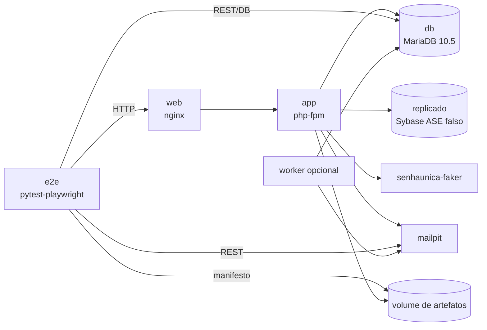
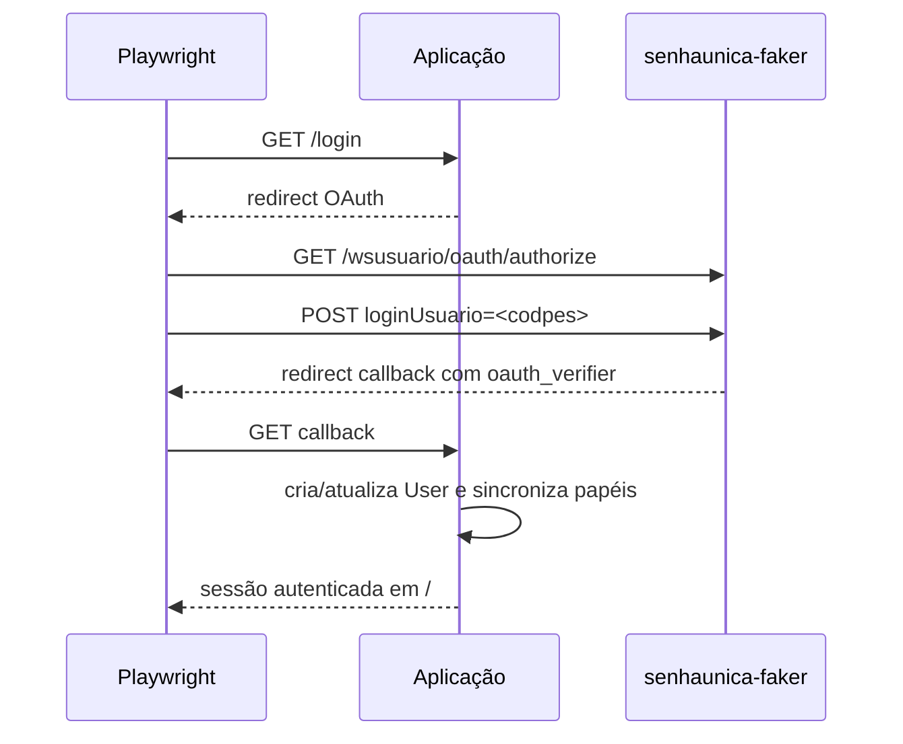

# Sistema de Monitoria — Documentação de Planejamento dos Testes E2E

**Projeto:** Sistema de Monitoria do IME (Instituto de Matemática e Estatística, USP)
**Stack alvo:** Playwright + Python (`pytest-playwright`)
**Documentos de referência:**
- `docs/TECHNICAL_DOCUMENTATION.md`
- `docs/SCENARIO_TESTS_DOCUMENTATION.md` (244 cenários `CEN-*`)

**Data:** 2026-11-19
**Status:** fundação implementada. Existem `docker-compose.e2e.yml`, imagens, seed, fixtures do Replicado, **41 testes Playwright** executando e a matriz dos 244 cenários (+ 10 cenários de regressão da UI legada). A cobertura completa ainda será construída incrementalmente.

### O que já está implementado

- `docker-compose.e2e.yml` com MariaDB 10.5, `senhaunica-faker`, Mailpit, app, nginx, seed e runner Playwright.
- Banco compatível com o dump de produção `monitoria_20262108_1400.sql` (MariaDB 10.5, `utf8mb4`, tabelas `utf8mb4_unicode_ci`). O schema foi comparado com `mariadb-dump --no-data`: as 34 tabelas, colunas, índices e constraints são idênticos; só o `AUTO_INCREMENT` dos dados de teste difere.
- `docker/e2e/Dockerfile.app`, entrypoints, nginx e imagem `e2e/Dockerfile` com Chromium.
- `php artisan e2e:seed`, manifesto `seed.json` e fixtures do Replicado em `replicado.json`.
- Fallback de Replicado por `E2E_REPLICADO_FAKE=true` (ver seção 7.5), necessário porque o ASE do `asedocker` sofre SIGSEGV no kernel deste ambiente.
- Suíte `e2e/tests` com **41 testes** P0/P1/P2 passando.
- `e2e/coverage.yaml` com os 244 `CEN-*` mapeados.
- `scripts/run_e2e.sh` e documentação de execução.

---

## Sumário

1. [Objetivo e escopo](#1-objetivo-e-escopo)
2. [Decisões de arquitetura](#2-decisões-de-arquitetura)
3. [Visão geral da stack](#3-visão-geral-da-stack)
4. [Docker Compose dedicado](#4-docker-compose-dedicado)
5. [Isolamento e variáveis de ambiente](#5-isolamento-e-variáveis-de-ambiente)
6. [Autenticação com senhaunica-faker](#6-autenticação-com-senhaunica-faker)
7. [Replicado falso (Sybase)](#7-replicado-falso-sybase)
8. [Banco local, seed e fixtures](#8-banco-local-seed-e-fixtures)
9. [Estrutura da suíte no repositório](#9-estrutura-da-suíte-no-repositório)
10. [Convenções de teste e seletores](#10-convenções-de-teste-e-seletores)
11. [Cobertura dos 244 cenários](#11-cobertura-dos-244-cenários)
12. [Casos especiais](#12-casos-especiais)
13. [Execução, scripts e CI](#13-execução-scripts-e-ci)
14. [Critérios de aceite da implementação](#14-critérios-de-aceite-da-implementação)
15. [Riscos e mitigações](#15-riscos-e-mitigações)
16. [Anexos](#16-anexos)

---

## 1. Objetivo e escopo

Esta documentação define como os testes E2E de navegador do Sistema de Monitoria serão construídos futuramente. O objetivo é validar as jornadas reais da aplicação contra uma stack Laravel completa, isolada e descartável, sem depender de serviços da USP.

### 1.1 O que é teste E2E neste projeto

- Navegador real (Chromium via Playwright) interagindo com a aplicação Laravel em execução.
- Aplicação real, banco MySQL próprio, filas, storage e e-mail controlados.
- Autenticação pelo fluxo OAuth simulado do `senhaunica-faker`, mantendo o caminho de login real do `senhaunica-socialite`.
- Replicado simulado por um Sybase ASE separado, com schema e fixtures mínimos.
- Dados determinísticos, criados por seed dedicado e descartados ao final da execução.

### 1.2 O que não é escopo

- Substituir os testes PHPUnit existentes (`tests/Unit` e `tests/Feature`).
- Testar regras que não têm superfície de navegador (jobs, commands, Kernel, models do Replicado) exclusivamente pelo browser. Esses cenários continuam em PHPUnit/console, mas entram na matriz de rastreabilidade e no mesmo pipeline.
- Testes de carga, performance, acessibilidade ou segurança.
- Uso de credenciais, banco ou serviços reais de produção.

### 1.3 Princípios

1. **Isolamento total:** nenhum serviço, volume, banco ou rede do ambiente de desenvolvimento é reutilizado.
2. **Determinismo:** dados e datas calculados no momento do seed, sem dependência de dados reais.
3. **Repetibilidade:** qualquer pessoa ou CI executa a mesma suíte do zero com `down -v` e `up`.
4. **Rastreabilidade:** todo cenário `CEN-*` tem um destino explícito: teste E2E, teste híbrido, teste não-UI ou justificativa de exclusão.
5. **Custo controlado:** a stack sobe apenas o necessário e é destruída ao final.

---

## 2. Decisões de arquitetura

| ID | Decisão | Justificativa |
|---|---|---|
| D1 | Playwright com Python + `pytest-playwright` | Mesmo padrão dos projetos `sistema_cea` e `verao`; container Python com Chromium é simples e já validado pela equipe. |
| D2 | `docker-compose.e2e.yml` dedicado, projeto `monitoria_e2e` | Não interfere no `docker-compose.yml` de desenvolvimento nem no banco local. |
| D3 | Banco MySQL dedicado e descartável | Base própria, sem dados de desenvolvimento; reset garantido com `down -v`. |
| D4 | `senhaunica-faker` como provedor OAuth | Mantém o fluxo real de login do `senhaunica-socialite`, sem tocar na USP. |
| D5 | Replicado real via `uspdev/asedocker`; fallback JSON quando o ASE não roda | Mantém o SQL real onde possível. O ASE 16 sofre SIGSEGV em kernels 7.x, então o padrão no ambiente atual é o fallback (`E2E_REPLICADO_FAKE=true`). |
| D6 | Mailpit para e-mail | Captura SMTP e expõe API para asserts de destinatário, assunto, corpo e links assinados. |
| D7 | Seed dedicado com manifesto JSON | Os testes não dependem de IDs fixos nem de `docker.sock`; o seed publica os IDs em um volume compartilhado. |
| D8 | Seed e testes executados em containers próprios | A aplicação testada é imutável (código na imagem), reduzindo diferenças entre máquina local e CI. |
| D9 | `QUEUE_CONNECTION=sync` por padrão | Jobs e e-mails executam no processo, simplificando a maioria dos cenários. Cenários de fila usam um profile opcional com worker. |
| D10 | Todos os 244 cenários entram na matriz | Cada `CEN-*` é classificado como UI, híbrido ou não-UI; nenhum fica sem destino. |

### 2.1 Alternativas descartadas

- **Dusk:** não é usado pela equipe e não compartilha o padrão Playwright dos demais projetos.
- **Stub do Replicado dentro da aplicação:** exigiria código de teste no produto e deixaria de exercitar as consultas SQL reais.
- **Reutilizar o banco de desenvolvimento:** risco de perda de dados e resultados não determinísticos.
- **Login por bypass de sessão:** mais rápido, porém não valida o fluxo OAuth nem a sincronização de papéis no login.

---

## 3. Visão geral da stack



Fluxo de login:



A aplicação continua usando `uspdev/senhaunica-socialite` e as consultas reais de `uspdev/replicado`; apenas os serviços externos são substituídos por simuladores locais.

---

## 4. Docker Compose dedicado

### 4.1 Arquivo e projeto

- Arquivo: `docker-compose.e2e.yml` na raiz do repositório.
- Projeto Compose: `monitoria_e2e` (sempre passar `-p monitoria_e2e`).
- Não importar, estender ou orquestrar o `docker-compose.yml` de desenvolvimento.
- Rede interna própria, sem a rede externa `web` e sem TLS.
- Portas de host apenas para depuração opcional (ex.: `127.0.0.1:8089` para o nginx e `127.0.0.1:8025` para o Mailpit). A suíte acessa os serviços por DNS interno: `http://web`.

### 4.2 Serviços

| Serviço | Imagem / build | Papel | Dependências |
|---|---|---|---|
| `db` | `mariadb:10.5` (pinado por digest) | Banco exclusivo `monitoria_e2e`, compatível com o dump de produção | — |
| `replicado` | `uspdev/asedocker` (profile `asedocker`) | Sybase ASE opcional; não roda em kernels 7.x | — |
| `replicado-init` | mesma imagem do `replicado` (profile `asedocker`) | One-shot que aguarda o ASE e executa o SQL de fixtures | `replicado` iniciado (com retry) |
| `senhaunica` | `uspdev/senhaunica-faker` (pinado) | OAuth USP simulado na porta 3141 | — |
| `mailpit` | `axllent/mailpit` | SMTP 1025 + API HTTP 8025 | — |
| `app` | `docker/e2e/Dockerfile.app` | php-fpm, código imutável, TeX/Python para PDFs | `db`, `senhaunica`, `mailpit` |
| `web` | `nginx` (pinado) + `docker/e2e/nginx.conf` | Entrada HTTP + assets do volume `e2e_public` | `app` |
| `seed` | mesma imagem do `app` | One-shot `migrate:fresh` + `php artisan e2e:seed`; grava manifesto e fixture do Replicado | `db` |
| `e2e` | `e2e/Dockerfile` | Python + Playwright + Chromium; executa o pytest | `web` saudável, `seed` concluído, `mailpit` |
| `worker` | mesma imagem do `app` (profile `async`) | `queue:work` para cenários de fila | `db`, `app` |
| `scheduler` | mesma imagem do `app` (profile `scheduler`) | `schedule:work`/`schedule:run` para cenários do Kernel | `db`, `app` |

Observações:

- `worker` e `scheduler` não sobem por padrão. Cenários que precisam deles usam profiles ou executam `php artisan queue:work --once` / `php artisan schedule:run` no container `app`.
- `seed` deve terminar com sucesso antes do `e2e` (`condition: service_completed_successfully`).
- O `replicado-init` deve ser idempotente e falhar de forma explícita se o schema não for aplicado.

### 4.3 Volumes e descarte

| Volume | Conteúdo | Descarte |
|---|---|---|
| `e2e_db_data` | Dados do MariaDB | `docker compose ... down -v` |
| `e2e_storage` | `storage/app`, `storage/logs`, `storage/framework` | `down -v` |
| `e2e_public` | `public/` da imagem (assets do tema) | `down -v` |
| bind `e2e/artifacts/` | Manifesto do seed, fixture do Replicado, traces, screenshots, vídeos | `down -v` não afeta o bind; arquivos ignorados pelo Git |

O ASE, quando usado no profile opcional, é efêmero (sem volume). O MariaDB, o storage e o `public` usam volumes nomeados para permitir inspeção durante uma execução e descarte garantido no fim. Os artefatos ficam no host para depuração.

### 4.4 Arquivo real

O `docker-compose.e2e.yml` é a fonte de verdade. Ele está fixado por digest, usa MariaDB 10.5, `senhaunica-faker`, Mailpit, o profile opcional `asedocker`, a imagem imutável da aplicação e o runner Playwright. Alterações de infraestrutura devem ser feitas nele e refletidas nesta documentação, sem manter um segundo esboço divergente.

### 4.5 Imagem da aplicação

Para o E2E, a aplicação deve ser construída **com o código dentro da imagem**, e não com bind mount do repositório. Isso garante que:

- o commit testado é exatamente o commit da imagem;
- `vendor/` e `node_modules/` não são sobrescritos pelo host;
- não há diferença entre execução local e CI.

O `Dockerfile` da raiz é a base de sistema (PHP, extensões, TeX, Python), mas não copia o código-fonte. O E2E usa `docker/e2e/Dockerfile.app`, derivado dele, com:

```dockerfile
FROM <imagem-base-construida-do-Dockerfile-da-raiz>
WORKDIR /var/www
COPY . /var/www
RUN composer install --no-interaction --no-dev --optimize-autoloader \
    && npm ci \
    && npm run build
```

Se preferir uma única imagem, o `Dockerfile` da raiz pode ser parametrizado para copiar o código apenas em builds E2E; a exigência é que a imagem final contenha `vendor/`, `node_modules/`/`public/` e o código do commit testado, sem depender de bind mount.

O Dockerfile de produção já instala PHP 8.5, `pdo_dblib`, TeX Live e Python 3, necessários para Replicado, atestados e relatórios. O entrypoint de E2E deve ser mínimo:

1. aguardar `db`;
2. aguardar `vendor/autoload.php`;
3. criar diretórios de `storage`, incluindo `storage/app/images` (copiado de `/opt/e2e-storage/images` para que atestados e relatórios encontrem os logos);
4. `php artisan storage:link`;
5. iniciar `php-fpm`.

Nada de `composer install`, `npm install`, geração de `.env` ou ajustes de UID em tempo de execução. Build de assets (`npm ci && npm run build`) acontece na construção da imagem.

O serviço `seed` é o único responsável pelo schema: ele valida `APP_ENV=testing`, `E2E_MODE=true` e `DB_DATABASE=monitoria_e2e`, aguarda `db`, executa `php artisan migrate:fresh --force` e depois `php artisan e2e:seed`. O `app` não roda migration, evitando corrida entre os dois.

---

## 5. Isolamento e variáveis de ambiente

### 5.1 Regras de isolamento

- O arquivo `.env` do repositório **não** é usado pela stack E2E.
- Toda configuração vem do `docker-compose.e2e.yml` (ou de um `.env.e2e` opcional, sem segredos).
- `APP_ENV=testing`, `E2E_MODE=true`.
- `SENTRY_LARAVEL_DSN` vazio; nenhum envio de erro para fora.
- `BROADCAST_DRIVER=log`.
- Comunicação de rede apenas entre containers da stack; nenhuma chamada a `replicado.ime.usp.br`, `dev.uspdigital.usp.br` ou CDNs de terceiros durante os testes (ver seção 10.6).
- Credenciais fixas e fictícias; nunca reutilizar senhas reais.
- `LOG_AS_ADMINISTRATOR` deve apontar para o `codpes` do usuário administrador de fixture ou ficar vazio; não usar o valor do `.env` de desenvolvimento.

### 5.2 Matriz de variáveis

| Variável | Valor E2E | Observação |
|---|---|---|
| `APP_ENV` | `testing` | Guarda de comandos destrutivos. |
| `APP_DEBUG` | `true` local / `false` CI | Em CI, falhas são diagnosticadas por trace e logs. |
| `APP_URL` | `http://web` | Precisa bater com o host usado pelo Playwright. |
| `APP_KEY` | chave fixa de teste | Gerar uma vez com `php artisan key:generate --show`; não é segredo. |
| `DB_CONNECTION` | `mysql` | — |
| `DB_HOST` / `DB_PORT` | `db` / `3306` | — |
| `DB_DATABASE` | `monitoria_e2e` | Nunca usar `monitoria` de desenvolvimento. |
| `DB_USERNAME` / `DB_PASSWORD` | `e2e` / `e2e` | Credenciais descartáveis. |
| `CACHE_DRIVER` | `file` | Evita cache compartilhado com o ambiente local. |
| `SESSION_DRIVER` | `file` | Sessão no volume dedicado. |
| `QUEUE_CONNECTION` | `sync` | Padrão; `database` apenas no profile `async`. |
| `FILESYSTEM_DRIVER` | `local` | Storage no volume dedicado. |
| `MAIL_MAILER` | `smtp` | — |
| `MAIL_HOST` / `MAIL_PORT` | `mailpit` / `1025` | — |
| `MAIL_FROM_ADDRESS` | `no-reply@monitoria.e2e` | Domínio fictício. |
| `CERTIFICATE_SECRETARIA_EMAIL` | `secretaria@monitoria.e2e` | Destino do pedido de atestado. |
| `BASE_PATH` | `/var/www` | Usado por LaraTeX/relatórios. |
| `PYTHON_CMD` | `/usr/bin/python3` | Scripts de relatório. |
| `SENHAUNICA_DEV` | `http://senhaunica:3141/wsusuario/oauth` | Ativa o faker. |
| `SENHAUNICA_KEY` / `SENHAUNICA_SECRET` | `e2e-key` / `e2e-secret` | Fictícios. |
| `SENHAUNICA_CALLBACK_ID` | `77` | Mesmo valor nos dois lados. |
| `SENHAUNICA_ADMINS` / `GERENTES` / `USERS` | vazio | Papéis vêm do seed. |
| `REPLICADO_HOST` / `PORT` | `replicado` / `5000` | Sybase falso. |
| `REPLICADO_DATABASE` | `replicado` | Criado pelo SQL de init. |
| `REPLICADO_USERNAME` / `PASSWORD` | `sa` / `Sybase123456789` | Credenciais do asedocker. |
| `REPLICADO_SYBASE` | `1` | — |
| `REPLICADO_CODUNDCLG` | `45` | Unidade IME nas fixtures. |
| `REPLICADO_PATHLOG` | `storage/logs/replicado.log` | Gravável no volume. |
| `UNIDADE` | `IME` | Usado na importação de turmas. |
| `IS_SUPERVISOR_CONFIG` | `false` | Jobs síncronos por padrão. |
| `LOG_AS_ADMINISTRATOR` | codpes do admin ou vazio | Evitar comportamento inesperado em outros usuários. |
| `E2E_MODE` | `true` | Habilita `e2e:seed`/`e2e:reset`; nunca em produção. |
| `TZ` | `America/Sao_Paulo` | Datas e prazos. |

### 5.3 Tempo

As regras de negócio usam `now()` e `date()` em vários pontos (janelas de período, frequência a partir do dia 20, agendador). O padrão é **não congelar o relógio**:

- o seed calcula datas relativas ao momento da execução;
- cenários que dependem de uma janela específica recebem um período semeado adequado;
- cenários impossíveis de reproduzir no dia corrente são marcados como condicionais e documentados.

Para os poucos cenários que exigem uma data exata (ex.: fechamento às 23:59 do `finished_at`), a alternativa é usar `libfaketime` apenas no container `app`/`scheduler` durante a execução do comando, sem alterar o código da aplicação. Isso é opcional e não deve ser o padrão da suíte.

---

## 6. Autenticação com senhaunica-faker

### 6.1 Funcionamento

O `senhaunica-faker` implementa as respostas OAuth1 consumidas pelo `uspdev/senhaunica-socialite`. A aplicação é configurada com:

```env
SENHAUNICA_DEV=http://senhaunica:3141/wsusuario/oauth
```

Fluxo executado pelo helper de login:

1. `page.goto("/login")` (ou clique em "Entrar" do `laravel-usp-theme`);
2. a aplicação redireciona para `/wsusuario/oauth/authorize` no faker;
3. o helper preenche `#callback` com `http://web/callback`, preenche `#loginUsuario` com o `codpes` do usuário e clica em "Login";
4. o faker redireciona para o callback da aplicação com `oauth_token` e `oauth_verifier`;
5. a aplicação cria/atualiza o `User`, sincroniza os vínculos do Replicado e autentica;
6. o helper aguarda a URL `/` e valida que o menu esperado apareceu.

O formulário do faker tem os campos `#callback`, `#loginUsuario`, `#oauth_token`, `#callback_id`. O helper preenche `#callback` com a URL da aplicação (`http://web/callback`) porque o faker usa o referer do request_token como valor padrão, que aponta para ele mesmo.

### 6.2 Definição dos vínculos no faker

O faker aceita duas formas de definir o vínculo de um `codpes`:

1. **Listas explícitas (recomendado):** variáveis `FAKER_SERVIDOR`, `FAKER_DOCENTE`, `FAKER_ESTAGIARIORH`, `FAKER_ALUNOGR` e `FAKER_ALUNOPOS`. Se o `codpes` estiver em uma lista, o vínculo correspondente é retornado, independentemente do prefixo.
2. **Regra automática por prefixo:** quando o `codpes` não está em nenhuma lista, o faker usa `intval(codpes / 10000)` e os bits do resultado, na ordem `SERVIDOR`, `DOCENTE`, `ESTAGIARIORH`, `ALUNOGR`, `ALUNOPOS`. Isso produz o seguinte mapeamento padrão:

| Prefixo | Bit | Vínculo devolvido |
|---|---|---|
| `100XX` | 1 | Servidor não-docente |
| `200XX` | 2 | Docente |
| `400XX` | 4 | Estagiário |
| `800XX` | 8 | Aluno de graduação |
| `1600XX` | 16 | Aluno de pós-graduação |

A página inicial do faker exibe uma legenda que pode estar defasada em relação ao código. Para evitar ambiguidade e permitir `codpes` estáveis, a stack E2E deve usar **listas explícitas**:

```env
FAKER_SERVIDOR=10001,10002,10003
FAKER_DOCENTE=20001,20002,20003,20004,20005,20006
FAKER_ALUNOGR=160001,160002,160003,160004
FAKER_ALUNOPOS=800001
```

Com isso, qualquer `codpes` da seção 6.3 tem vínculo determinístico, inclusive combinações (ex.: servidor + aluno) se forem necessárias em cenários futuros.

As fixtures devem usar exclusivamente os `codpes` definidos nessas listas. Não usar os `codpes` aleatórios de 7 dígitos dos stubs PHPUnit.

### 6.3 Usuários de fixture

| Papel | `codpes` | Vínculo faker | Entidades locais |
|---|---|---|---|
| Administrador | `10001` | Servidor | `Administrador` |
| Secretaria | `10002` | Servidor | `Secretaria` |
| Servidor sem papel | `10003` | Servidor | — (para 403) |
| Docente da turma | `20001` | Docente | `Docente`, `Instructor` do MAC, turmas |
| Membro de comissão (MAC) | `20002` | Docente | `Docente`, `Membro Comissão`, `Instructor` do MAC |
| Presidente de comissão | `20003` | Docente | `Docente`, `Presidente de Comissão` |
| Vice-presidente | `20004` | Docente | `Docente`, `Vice Presidente de Comissão` |
| Membro de comissão (MAE) | `20005` | Docente | `Docente`, `Membro Comissão`, `Instructor` do MAE |
| Docente sem turma | `20006` | Docente | `Docente`, sem turma no período |
| Aluno com histórico/inscrição | `160001` | AlunoGR | `Aluno`, `Student`, histórico, inscrições |
| Aluno monitor ativo | `160002` | AlunoGR | `Aluno`, `Student`, `Selection` Ativo |
| Aluno sem histórico | `160003` | AlunoGR | `Aluno`, `Student`, sem `SchoolRecord` |
| Aluno com monitoria concluída | `160004` | AlunoGR | `Aluno`, `Student`, `Selection` Concluído |
| Aluno de pós-graduação | `800001` | AlunoPOS | `Aluno`, `Student` de pós |

Regras:

- O login dispara `syncVinculoRoles()` no model `User`, que consulta o Replicado falso e adiciona/remove `Aluno` e `Docente`.
- Papéis especiais (`Administrador`, `Secretaria`, `Membro Comissão`, etc.) devem ser atribuídos pelo seed **depois** que o Replicado falso estiver disponível.
- `LOG_AS_ADMINISTRATOR` não deve ser usado para conceder acesso nos testes; o papel é atribuído explicitamente.
- Para múltiplos usuários simultâneos, usar um `browser_context` por papel. Não compartilhar cookies entre papéis.

### 6.4 Helper de autenticação

Contrato previsto para `e2e/support/auth.py`:

```python
def login_as(page, codpes: str) -> None: ...
def new_context_as(browser, role: str) -> BrowserContext: ...
def storage_state_for(browser, role: str, force: bool = False) -> str: ...
```

- `login_as` executa o fluxo OAuth completo e falha se o menu do papel não aparecer.
- `storage_state_for` pode reaproveitar a sessão de um papel durante a suíte para reduzir tempo, desde que o teste não altere a sessão.
- Testes que validam login/logout/403 não devem reutilizar `storage_state`.

---

## 7. Replicado falso

### 7.1 Serviço Sybase (opcional)

- Imagem: `uspdev/asedocker`, fixada por digest, no profile `asedocker`.
- Hostname: `sybase` (exigido pela configuração interna do ASE) e alias `replicado` na rede Compose.
- Porta interna: `5000`.
- Credenciais: `sa` / `Sybase123456789`.
- Banco: `replicado`, criado pelo SQL de init.
- O container é efêmero e sem volume persistente: cada `up` recria o estado.

**Importante:** o ASE 16 do `asedocker` sofre `SIGSEGV` no kernel 7.x deste ambiente (confirmado em dois containers independentes). Por isso o profile `asedocker` não sobe por padrão; a suíte usa o fallback JSON documentado em 7.5.

### 7.2 Inicialização

O serviço `replicado-init`:

1. aguarda o ASE aceitar conexões (`tsql`/`isql` com retry);
2. executa `CREATE DATABASE replicado`;
3. executa o DDL e os `INSERT`s de fixtures;
4. executa uma consulta de verificação e falha se as tabelas/linhas mínimas não existirem.

O SQL é gerado a partir de um template (`e2e/fixtures/replicado/replicado.sql.tmpl`) com os valores do período corrente:

- `E2E_TERM_YEAR` (ex.: `2026`);
- `E2E_TERM_PERIOD_CODE` (`1` ou `2`);
- datas de início/fim de turma coerentes com o período local.

O `asedocker` não executa `database.sql` automaticamente; por isso o init é obrigatório. O binário `isql` está disponível na própria imagem.

### 7.3 Tabelas e colunas mínimas

As consultas reais do código usam as tabelas abaixo. As fixtures precisam conter ao menos estas colunas e linhas:

| Tabela | Colunas usadas pelo código | Uso |
|---|---|---|
| `PESSOA` | `codpes`, `nompes`, `nompesttd`, `sexpes`, `dtanas` | Nome, sexo, pessoa |
| `EMAILPESSOA` | `codpes`, `codema`, `stamtr` | E-mail (`stamtr='S'`) |
| `VINCULOPESSOAUSP` | `codpes`, `tipvin`, `tipfnc`, `codset`, `dtainivin`, `dtafimvin` | Vínculos, papel automático, docente |
| `TELEFPESSOA` | `codpes`, `codddi`, `codddd`, `numtel`, `tiptelpes` | Telefones |
| `SETOR` | `codset`, `nomabvset`, `nomset`, `codund`, `tipset` | Departamentos |
| `UNIDADE` | `codund`, `sglund`, `nomund` | IME/USP |
| `TURMAGR` | `coddis`, `codtur`, `verdis`, `dtainitur`, `dtafimtur`, `tiptur`, `numins`, `numinscpl`, `numinsopt`, `numinsecr`, `numinsoptlre` | Turmas e estimativa de inscritos |
| `DISCIPLINAGR` | `coddis`, `verdis`, `nomdis` | Nome da disciplina |
| `DISCIPGRCODIGO` | `coddis`, `pfxdisval`, `codclg` | Prefixo/departamento da disciplina |
| `PREFIXODISCIP` | `codset`, `codclg` | Disciplinas por instituto |
| `MINISTRANTE` | `coddis`, `codtur`, `codperhor`, `codpes` | Docentes da turma |
| `OCUPTURMA` | `coddis`, `codtur`, `codperhor`, `diasmnocp` | Horários |
| `PERIODOHORARIO` | `codperhor`, `horent`, `horsai` | Faixa de horário |
| `PROGRAMAGR` | `codpes`, `codpgm`, `dtaing`, `stapgm` | Programa de graduação |
| `HABILPROGGR` | `codpes`, `codpgm`, `codcur` | Habilitação |
| `CURSOGR` | `codcur`, `codclg` | Curso de graduação |
| `COLEGIADO` | `codclg`, `sglclg`, `codundrsp` | Colegiado |
| `AGPROGRAMA` | `codpes`, `codare`, `dtaselpgm`, `nivpgm` | Pós-graduação |
| `AREA` | `codare`, `codcur` | Área |
| `NOMECURSO` | `codcur`, `nomcur` | Nome do curso |
| `CURSO` | `codcur`, `codclg` | Curso |

### 7.4 Fixtures mínimas

- `PESSOA`/`EMAILPESSOA` para todos os `codpes` da seção 6.3.
- `VINCULOPESSOAUSP`:
  - docentes: `tipvin='SERVIDOR'`, `tipfnc='Docente'`, `codset` do departamento, `dtainivin` no passado, `dtafimvin` nulo;
  - servidores não docentes (admin/secretaria): `tipvin='SERVIDOR'`, `tipfnc` diferente de `Docente` (ex.: `Administrativo`), para não receberem o papel `Docente`;
  - alunos: `tipvin='ALUNOGR'` ou `'ALUNOPOS'`, `dtafimvin` nulo;
  - um aluno com vínculo encerrado para cenários de histórico.
- `SETOR`/`UNIDADE`: IME (`codund=45`, `sglund='IME'`) e departamentos MAC, MAE, MAP, MAT (`codset=5000..5003`, `nomabvset` correspondente).
- `TURMAGR`/`DISCIPLINAGR`/`DISCIPGRCODIGO`: ao menos 4 disciplinas, uma por departamento, com `codtur` do período corrente e uma turma extra para conflito.
- `MINISTRANTE`/`OCUPTURMA`/`PERIODOHORARIO`: docentes e horários das turmas.
- `PROGRAMAGR`/`HABILPROGGR`/`CURSOGR`/`COLEGIADO`: aluno de graduação `160001`.
- `AGPROGRAMA`/`AREA`/`NOMECURSO`/`CURSO`: aluno de pós `800001`.
- `FAKER_CODIGOS_SETOR=5000,5001,5002,5003` para manter o campo de setor do faker coerente com as fixtures. O departamento usado pela aplicação vem de `VINCULOPESSOAUSP.codset` no Replicado falso, e não do faker.

### 7.5 Fallback implementado: Replicado em JSON

Quando `E2E_REPLICADO_FAKE=true` (padrão), o `E2eServiceProvider` faz `class_alias` de `Uspdev\Replicado\DB` para `App\Support\E2e\FakeReplicadoDb`. O alias só é aplicado com `E2E_MODE=true` **e** `APP_ENV=testing`; fora de testing o provider lança exceção, então produção e PHPUnit não são afetados.

- O seed grava `/e2e-artifacts/replicado.json` antes de criar os usuários.
- O fake responde às mesmas chamadas `DB::fetch`/`DB::fetchAll` usadas pelos models e pelo pacote `Pessoa`.
- As fixtures são as mesmas tabelas da seção 7.3, cobrindo login, turmas, departamentos, cursos e frequência.
- A matriz de cenários marca `CEN-REPLICADO-*` como `non-ui`; os demais fluxos de navegador exercitam o código de consulta real, apenas com o driver de dados substituído.
- Para usar o ASE real em um kernel compatível: `docker compose ... --profile asedocker up ...` e definir `E2E_REPLICADO_FAKE=false`. O fallback é o modo padrão e o único validado neste ambiente.

---

## 8. Banco local, seed e fixtures

### 8.1 Comandos previstos

| Comando | Responsabilidade |
|---|---|
| `php artisan e2e:seed` | `migrate:fresh`, seed base e geração do manifesto JSON. |
| `php artisan e2e:reset` | Recria o banco e o seed base; usado entre execuções e por cenários que exigem estado limpo. |
| `php artisan e2e:make --scenario=<nome> --json` | Cria dados adicionais para um cenário específico e devolve IDs em JSON. |
| `php artisan e2e:signed-url --route=... --params=...` | Auxiliar: gera URL assinada para depuração ou para o manifesto; não é pré-requisito da suíte. |

Todos devem abortar se `APP_ENV` não for `testing` ou se `E2E_MODE` não for `true`.

### 8.2 Conteúdo do seed base

| Grupo | Dados |
|---|---|
| Papéis/permissões | `RolesAndPermissionsSeeder`, permissão `admin` usada pelo Gate do tema e permissões internas `admin`/`gerente`/`user` do `senhaunica-socialite`. |
| Catálogos | Atividades padrão, bolsas (`PEEG`, `PAE`). |
| Usuários | Tabela da seção 6.3, com papéis e vínculos. |
| Departamentos | MAC, MAE, MAP, MAT. |
| Períodos | Aberto, fechado, futuro, passado e em avaliação; apenas um `Aberto`. |
| Turmas | Turmas do docente, de outro docente, de outro departamento e duplicada. |
| Solicitações | Com atividades, recomendações, bolsas e assinatura do instrutor. |
| Alunos | Com/sem histórico, graduação/pós, com/sem inscrição. |
| Históricos | PDFs válidos no storage. |
| Inscrições | Múltiplas turmas da mesma `coddis`, preferências e observações. |
| Seleções | Ativo, Concluído, Desligado, voluntário e não voluntário. |
| Frequências | Registradas/não registradas, meses passados/atuais/futuros. |
| Modelos de e-mail | Um por `mail_class`, com variantes Manual e agendada. |
| Relatórios/atestados | Massa mínima para gerar PDF. |
| OldDB | CSV válido e CSV com erro de colunas. |

### 8.3 Manifesto

O seed grava `/e2e-artifacts/seed.json` com IDs, chaves e metadados:

```json
{
  "term": {"open_id": 1, "year": 2026, "period": "1° Semestre"},
  "users": {
    "admin": {"id": 1, "codpes": "10001", "role": "Administrador"},
    "docente": {"id": 2, "codpes": "20001", "role": "Docente"}
  },
  "departments": {"MAC": 1, "MAE": 2},
  "classes": {"MAC0101": {"id": 1, "codtur": "2026110"}},
  "requisitions": {"MAC0101": 1},
  "students": {"com_historico": {"id": 1, "codpes": "160001"}},
  "selections": {"ativo": 1, "concluido": 2, "desligado": 3},
  "frequencies": {"passada_nao_registrada": 1},
  "mail_templates": {"manual": 1, "unica": 2},
  "files": {"edital": "20261/edital_e2e.pdf", "historico": "..."}
}
```

Os testes **não devem hardcodear IDs**. O helper `e2e/support/manifest.py` carrega o JSON e expõe acessores.

### 8.4 Estratégia de datas

- O seed roda no momento da suíte e calcula todas as datas a partir de `now()`.
- Período principal: status `Aberto`, janelas de solicitação/inscrição incluindo o dia atual, janela de avaliação conforme o cenário.
- Períodos auxiliares: `Fechado`, `Futuro`, `Passado`, `Avaliação`.
- Frequências:
  - meses anteriores ao atual: sempre liberados para edição;
  - mês atual: liberado apenas se o dia for `>= 20`;
  - meses futuros: bloqueados.
- Modelos agendados: `sending_date`/`sending_hour` calculados para que o `schedule:run` execute no minuto corrente quando o cenário testar o agendador.
- Nenhuma data fixa como `01/01/2026` deve aparecer nos testes.

### 8.5 Isolamento entre testes

- A stack já é isolada; o banco é descartado ao final da execução.
- Cada teste cria dados com sufixo único (ex.: `E2E-<uuid>` em nomes/observações) para não colidir com o seed base.
- Testes não dependem de ordem de execução.
- O estado base é somente leitura para a maioria dos testes; cenários que alteram o período aberto usam um período próprio criado para o teste.
- Limpeza por teste só é necessária quando o dado afeta outros testes; caso contrário, o descarte do banco resolve.
- Paralelização (`pytest-xdist`) não é adotada na primeira versão. Se necessária, cada worker deve receber banco/schema próprio ou dados com sufixo exclusivo.

### 8.6 Arquivos de fixture

- PDFs mínimos e válidos para edital e histórico escolar (poucos KB).
- CSV de importação do banco antigo com cabeçalho e uma linha completa.
- CSV inválido com contagem de colunas errada.
- Nenhum arquivo real de aluno ou documento da USP.

---

## 9. Estrutura da suíte no repositório

```text
docker-compose.e2e.yml
.env.e2e.example
docker/
  e2e/
    Dockerfile.app
    app-entrypoint.sh
    seed-entrypoint.sh
    nginx.conf
e2e/
  Dockerfile
  requirements.txt
  pytest.ini
  conftest.py
  support/
    auth.py
    manifest.py
    db.py
  fixtures/
    replicado/
      init-replicado.sh
      replicado.sql.tmpl
    pdf/
      edital.pdf
    olddb/
      import_valido.csv
      import_invalido.csv
  pages/
    login.py
    schoolterms.py
    schoolclasses.py
    requisitions.py
    enrollments.py
    selections.py
    frequencies.py
    tutors.py
    certificates.py
    selfevaluations.py
    instructorevaluations.py
    mailtemplates.py
    emails.py
    users.py
    reports.py
    olddb.py
  tests/
    test_auth.py
    test_schoolterms.py
    test_schoolclasses.py
    test_requisitions.py
    test_schoolrecords.py
    test_enrollments.py
    test_selections.py
    test_frequencies.py
    test_tutors.py
    test_certificates.py
    test_selfevaluations.py
    test_instructorevaluations.py
    test_mailtemplates.py
    test_emails.py
    test_users.py
    test_reports.py
    test_olddb.py
    test_commands_jobs_kernel.py
    test_ui_legacy.py
  artifacts/            # gitignored
scripts/
  run_e2e.sh
```

### 9.1 Dependências Python

```text
pytest==9.2.0
pytest-playwright==0.10.0
pytest-timeout==2.4.0
PyMySQL==1.2.4
playwright==1.65.2
```

- `pymysql` serve para leitura/asserts e preparação controlada de estados que não têm UI.
- `pytest-timeout` evita testes pendurados.
- Quando os testes de e-mail/PDF forem implementados, adicionar `requests` (Mailpit) e `pypdf` (validação de PDF).

### 9.2 Marcadores `pytest`

```ini
[pytest]
markers =
    p0: jornada crítica do ciclo anual
    p1: módulos complementares
    p2: casos de borda e permissões
    mail: depende do Mailpit
    pdf: gera ou valida PDF
    replicado: depende do Sybase falso
    queue: exige worker/profile async
    kernel: executa schedule:run
    slow: execução longa
```

`--strict-markers` deve estar habilitado para impedir marcadores inválidos.

---

## 10. Convenções de teste e seletores

### 10.1 Organização dos testes

- Um arquivo por módulo; um teste por cenário `CEN-*`, quando o cenário for de navegador.
- Nome do teste contém o ID: `test_cen_schoolterm_001_...`.
- Docstring curta com o cenário e a regra de negócio.
- Testes de autorização agrupados por papel (`parametrize`) para evitar duplicação.
- Um assert principal por teste; asserts auxiliares são permitidos para confirmar estado.
- Setup via manifesto/seed; ações via UI; asserções via UI, salvo quando o cenário exigir banco, arquivo ou e-mail.

### 10.2 Seletores

Preferência:

1. `get_by_role` + nome acessível;
2. `get_by_label`;
3. `get_by_text` para mensagens e títulos;
4. `data-testid` para elementos ambíguos.

Adicionar `data-testid` somente onde o HTML atual não oferece um seletor estável. Candidatos:

- linhas de tabela que precisam ser localizadas por `coddis`/`codpes`;
- botões de ação em modais;
- campos gerados dinamicamente (atividades, recomendações, horários);
- mensagens de flash padronizadas.

Evitar:

- seletores por posição (`nth-child`) sem âncora textual;
- classes Bootstrap como identificador único;
- XPath estrutural;
- dependência de IDs internos do DataTables/TinyMCE.

### 10.3 Sincronização

- Nunca usar `time.sleep`.
- Usar `expect(...)` com timeout padrão e `page.wait_for_url` para navegações.
- Desabilitar animações via CSS injetado para reduzir flutuação.
- Para DataTables, aguardar a linha esperada aparecer, não a tabela inteira.
- Para TinyMCE, usar o helper de conteúdo do iframe ou preencher via API do editor quando o campo for obrigatório.
- Para downloads, usar `expect_download` e validar nome/tipo/conteúdo.

### 10.4 Dados únicos

- Prefixo `E2E-` em nomes de turmas, descrições de solicitações e observações.
- Sufixo curto por teste (`uuid4().hex[:8]`) para evitar colisão em cenários que criam registros.
- Não usar nomes reais de pessoas.

### 10.5 Erros e artefatos

- `pytest-playwright`: `--tracing=retain-on-failure`, `--screenshot=only-on-failure`, `--video=retain-on-failure`.
- Relatório HTML em `e2e/artifacts/report.html`.
- Em falha, anexar URL, papel autenticado, ID do cenário e último request relevante.
- Logs da aplicação (`storage/logs/laravel.log`) copiados para os artefatos quando o teste falhar.

### 10.6 Recursos externos e CDNs

As views carregam recursos de CDN:

- jQuery UI (`code.jquery.com`);
- DataTables (`cdn.datatables.net`);
- TinyMCE (`cdn.tiny.cloud`);
- Font Awesome (`netdna.bootstrapcdn.com`).

Para determinismo e execução sem internet, a implementação deve escolher uma das opções:

1. **Recomendado:** servir cópias locais desses assets no ambiente E2E (vendorizar ou montar arquivos estáticos), garantindo o mesmo comportamento visual/funcional;
2. interceptar as requisições no Playwright e responder com arquivos locais;
3. permitir egress apenas para esses domínios (menos determinístico, não recomendado em CI).

A opção 1 exige uma pequena alteração nas views ou no layout para usar `asset()`/URL configurável. A opção 2 não altera a aplicação, mas precisa cobrir todos os assets e versões. Nenhuma das duas deve mascarar falhas de JavaScript da aplicação.

---

## 11. Cobertura dos 244 cenários

### 11.1 Classificação

- **UI:** todas as etapas e asserções passam pelo navegador.
- **HÍBRIDO:** a pré-condição é criada por seed/console/banco e a ação/asserção principal passa pelo navegador.
- **NÃO-UI:** não há superfície de navegador; permanece em PHPUnit/console e é referenciado na matriz E2E.

Todos os 244 `CEN-*` da `docs/SCENARIO_TESTS_DOCUMENTATION.md` entram na matriz `e2e/coverage.yaml`. Um cenário só pode ficar sem teste E2E se tiver justificativa e um teste não-UI associado.

### 11.2 Distribuição por módulo

| Módulo | CENs | Classificação principal | Rotas/entradas | Observações |
|---|---:|---|---|---|
| `SCHOOLTERM` | 22 | UI + híbrido | `/schoolterms` | Upload/download de edital e validações de datas. |
| `SELECTION` | 18 | UI + híbrido | `/selections`, `/selections/{id}/enrollments` | Escopo por papel e departamento; bloqueios. |
| `REQUISITION` | 18 | UI | `/requisitions` | Formulário com atividades, recomendações e bolsas. |
| `SCHOOLCLASS` | 16 | UI + híbrido | `/schoolclasses` | Import do Replicado é assíncrono/síncrono. |
| `ENROLLMENT` | 16 | UI | `/enrollments` | Múltiplas turmas da mesma `coddis`. |
| `EMAIL` | 16 | UI + mailpit | `/emails` | Disparos e modelos ativos. |
| `SELFEVAL` | 15 | UI + links assinados | `/selfevaluations` | Janela de avaliação. |
| `MAILTEMPLATE` | 13 | UI + mailpit | `/mailtemplates` | CRUD, ativação e teste de envio. |
| `TUTOR` | 11 | UI | `/tutors` | Revogar, voluntário e escopo. |
| `FREQUENCY` | 11 | UI + regra de data | `/frequencies` | Dia 20 e mês futuro. |
| `USER` | 10 | UI + híbrido | `/users` | Papéis, busca e login. |
| `INSEVAL` | 10 | UI + links assinados | `/instructorevaluations` | Janela de avaliação. |
| `CMD` | 10 | NÃO-UI | `artisan` | Executar no container e validar stdout/exit code/DB. |
| `REPLICADO` | 9 | NÃO-UI | models | Validar contra o Sybase falso; sem navegador. |
| `KERNEL` | 8 | NÃO-UI/híbrido | `schedule:run` | Datas calculadas; Mailpit para e-mails. |
| `SCHOOLRECORD` | 7 | UI + upload/download | `/schoolRecords` | PDF e unicidade. |
| `REPORT` | 7 | UI + PDF | `/reports` | Token externo e geração LaTeX. |
| `CERTIFICATE` | 7 | UI + PDF | `/certificates` | Atestado e envio à Secretaria. |
| `OLDDB` | 6 | UI + job | `/olddb` | CSV e importação. |
| `INSTRUCTOR` | 6 | UI + replicado | `/instructors` | Busca por `codpes`. |
| `STUDENT` | 4 | UI + replicado | `/students` | Busca e vínculos. |
| `JOB` | 4 | NÃO-UI | queue | Worker ou `queue:work --once`. |
| **Total** | **244** | | | |

### 11.3 Jornadas críticas (P0)

As jornadas abaixo formam o primeiro conjunto a implementar e devem rodar em menos de 10 minutos:

1. Login como Admin/Secretaria/Docente/Aluno e visibilidade de menu.
2. Criação e edição de período letivo, upload de edital e período aberto.
3. Cadastro de turma, instrutores e horários; importação do Replicado.
4. Solicitação de monitor pelo docente, com atividades, recomendações e bolsas.
5. Inscrição do aluno, envio de histórico e limite de inscrições.
6. Seleção de monitor pela comissão, incluindo bloqueios e escopo por departamento.
7. Registro de frequência e regra do dia 20.
8. Revogação/desligamento e alternância de voluntário.
9. Autoavaliação e avaliação do docente por links assinados.
10. Emissão de atestado e download do PDF.
11. Disparo de e-mail e verificação no Mailpit.
12. Ciclo completo: período → turma → solicitação → inscrição → seleção → frequência → atestado.

### 11.4 Rastreabilidade

Formato previsto para `e2e/coverage.yaml`:

```yaml
- cen: CEN-SCHOOLTERM-001
  module: SCHOOLTERM
  type: ui
  test: tests/test_schoolterms.py::test_cen_schoolterm_001_periodo_aberto_duplicado
  priority: p0
  status: planned
- cen: CEN-KERNEL-005
  module: KERNEL
  type: non-ui
  test: tests/test_commands_jobs_kernel.py::test_cen_kernel_005_fechamento
  priority: p1
  status: planned
  note: executado via schedule:run no container app
```

Regras:

- `type: ui|hibrido|non-ui`.
- `status: planned|implemented|blocked`.
- Cenários não-UI precisam de `note` explicando por que não usam navegador.
- O pipeline deve falhar se houver `CEN-*` sem entrada na matriz ou se um `test` apontar para nodeid inexistente.

### 11.5 Cenários que não fazem sentido no navegador

- `CEN-JOB-*`: jobs e monitor de fila.
- `CEN-KERNEL-*`: agendador; podem ser híbridos quando o efeito é visível (e-mail, seleção concluída).
- `CEN-CMD-*`: comandos de console; validar stdout, exit code e banco.
- `CEN-REPLICADO-*`: models e SQL; validar contra o Sybase falso.
- Partes de `CEN-OLDDB-*` e `CEN-SCHOOLCLASS-*` que testam processamento interno do job, sem tela.

Esses cenários continuam no pipeline como testes PHPUnit/console, executados antes ou depois da suíte Playwright, e aparecem na matriz como `non-ui`.

---

## 12. Casos especiais

### 12.1 E-mail (Mailpit)

- Antes de cada teste que valida e-mail: `DELETE /api/v1/messages`.
- Listar: `GET /api/v1/messages`.
- Detalhar: `GET /api/v1/message/{ID}`.
- Validar remetente, destinatário, assunto, corpo HTML/texto e anexos.
- Extrair links assinados do corpo e navegar por eles.
- Validar links expirados/adulterados quando o cenário exigir.
- Com `QUEUE_CONNECTION=sync`, o e-mail chega antes da resposta HTTP terminar. Com fila real, aguardar o Mailpit com polling limitado.

### 12.2 PDFs

- Upload: `set_input_files` com PDFs de fixture.
- Download: `expect_download`, validar `suggested_filename` e, após adicionar `pypdf`, conferir o texto mínimo.
- Atestados e relatórios usam LaraTeX/pdflatex e Python, já presentes na imagem da aplicação. O container `e2e` não precisa de TeX.
- Validar também os casos de erro (arquivo não-PDF, acima do limite, caminho inexistente).

### 12.3 Links assinados

- Preferir URLs obtidas do Mailpit (fluxo real) ou do manifesto do seed (URLs pré-calculadas para as seleções semeadas).
- Testar URL válida, URL com hash alterado e URL de outro usuário.
- Não reutilizar URL assinada entre testes; elas carregam IDs e expiração.
- O runner **não** precisa de `docker.sock`: a geração ad-hoc via `e2e:signed-url` é apenas uma ferramenta de manutenção/depuração no host.

### 12.4 Filas e jobs

- Padrão: `QUEUE_CONNECTION=sync`; o job executa no request.
- Para validar o comportamento de fila: subir o profile `async` (`worker`), usar `QUEUE_CONNECTION=database` e aguardar o monitor (`/monitor/getimportschoolclassesjob`, `/monitor/getImportOldDBJob`) ou executar `queue:work --once`.
- O teste não deve depender de tempo indefinido; usar timeout e mensagem clara.

### 12.5 Kernel/agendador

- Criar modelos com `sending_date`/`sending_hour` iguais ao minuto corrente e executar `php artisan schedule:run` no container `app`.
- Para fechamento de período, `finished_at` deve ser hoje e o teste precisa rodar às 23:59; caso contrário, marcar como `xfail`/`non-ui` ou usar `libfaketime`.
- Sempre limpar e-mails antes de validar o disparo agendado.

### 12.6 Importação do banco antigo

- CSV válido e inválido em fixtures.
- `IS_SUPERVISOR_CONFIG=false` executa o job de forma síncrona; o progresso pode ser consultado no monitor.
- Validar a cadeia criada (período, turma, docente, aluno, seleção) e os erros reportados por linha.

### 12.7 Autorização e menus

- Para cada papel, validar as entradas visíveis no menu lateral e o 403 nas rotas proibidas.
- Não testar apenas a ausência do link; acessar a URL diretamente.
- O login como usuário sem papel deve permanecer autenticado, mas sem acesso às áreas restritas.

---

## 13. Execução, scripts e CI

### 13.1 Pré-requisitos

- Docker Engine + Docker Compose v2.
- Acesso à internet apenas para o build inicial das imagens e para o pull do `asedocker`/`senhaunica-faker`.
- ~4 GB de RAM e ~3 GB de disco para a stack.
- Nenhuma variável de produção no shell.

### 13.2 Comandos

```bash
# execução completa (limpa, sobe, semeia, roda e derruba)
./scripts/run_e2e.sh

# somente P0
./scripts/run_e2e.sh -m p0

# manter a stack para depuração
E2E_KEEP_STACK=1 ./scripts/run_e2e.sh -k schoolterm
```

Equivalente manual:

```bash
docker compose -p monitoria_e2e -f docker-compose.e2e.yml down -v --remove-orphans
docker compose -p monitoria_e2e -f docker-compose.e2e.yml up -d --build --wait \
  db senhaunica mailpit app web seed
docker compose -p monitoria_e2e -f docker-compose.e2e.yml run --rm e2e \
  pytest -q tests -c pytest.ini
docker compose -p monitoria_e2e -f docker-compose.e2e.yml down -v --remove-orphans
```

### 13.3 `scripts/run_e2e.sh`

Responsabilidades implementadas:

1. define `monitoria_e2e` e o arquivo `docker-compose.e2e.yml`;
2. derruba uma execução anterior (`down -v`);
3. sobe `db`, `senhaunica`, `mailpit`, `app`, `web` e `seed` com `--wait`;
4. executa o container `e2e` com os argumentos recebidos;
5. no `EXIT`, derruba a stack e os volumes, salvo `E2E_KEEP_STACK=1`;
6. retorna o código de saída do pytest.

Variáveis úteis:

- `E2E_KEEP_STACK=1`: mantém containers e volumes;
- argumentos após o script são repassados ao pytest (`-m p0`, `-k schoolterms`, `-x`).

### 13.4 Depuração

```bash
# manter a stack
E2E_KEEP_STACK=1 ./scripts/run_e2e.sh -m p0

# inspecionar
docker compose -p monitoria_e2e -f docker-compose.e2e.yml logs -f app
docker compose -p monitoria_e2e -f docker-compose.e2e.yml exec app php artisan tinker
docker compose -p monitoria_e2e -f docker-compose.e2e.yml exec app sh

# abrir trace localmente
playwright show-trace e2e/artifacts/<teste>/trace.zip
```

O Playwright roda headless no container. Para depuração visual, usar trace/screenshot/vídeo em vez de modo headed; uma imagem com VNC é opcional e não faz parte do escopo inicial.

### 13.5 CI

Pipeline previsto (GitHub Actions ou equivalente):

1. checkout;
2. build das imagens com cache de camadas;
3. `down -v` preventivo;
4. `up -d --build --wait`;
5. executar testes PHPUnit existentes (gate complementar);
6. executar `pytest -m "p0 or p1"`;
7. publicar `e2e/artifacts` como artifact em sucesso/falha;
8. `down -v` sempre;
9. timeout do job (ex.: 60 min) e timeout por teste.

Nenhum secret é necessário. As credenciais são fixas e fictícias.

---

## 14. Critérios de aceite da implementação

A implementação futura será considerada concluída quando:

- [x] `docker-compose.e2e.yml` sobe do zero com `up --wait` e não usa serviços/volumes do ambiente de desenvolvimento.
- [x] O banco local é criado, migrado e semeado sem intervenção manual.
- [x] O Replicado falso responde a todas as consultas usadas pelas jornadas cobertas.
- [x] O login via `senhaunica-faker` funciona para todos os papéis da seção 6.3.
- [x] O seed grava o manifesto e nenhum teste hardcodeia IDs.
- [x] Todos os 244 `CEN-*` estão em `e2e/coverage.yaml` com tipo, prioridade e destino.
- [x] As jornadas P0 passam de forma estável em três execuções consecutivas (41 testes, incluindo a UI legada).
- [ ] Nenhum teste faz chamada a `replicado.ime.usp.br`, `dev.uspdigital.usp.br` ou CDN externa.
- [ ] E-mails são validados pelo Mailpit, incluindo links assinados.
- [ ] PDFs de atestado, relatório e histórico são baixados e validados.
- [ ] Cenários de fila e Kernel têm estratégia explícita e não dependem de espera arbitrária.
- [x] `scripts/run_e2e.sh` derruba a stack e os volumes ao final, inclusive em falha.
- [x] Artefatos de falha (trace, screenshot, vídeo, logs) são publicados.
- [x] A suíte completa executa em ~40s neste ambiente (meta: P0 < 10 min; completa < 45 min).
- [x] O README documenta como rodar, depurar e atualizar as fixtures.

---

## 15. Riscos e mitigações

| Risco | Impacto | Mitigação |
|---|---|---|
| `uspdev/asedocker` arquivado, sem atualizações e com SIGSEGV em kernels 7.x | Alto | ASE mantido no profile opcional; fallback JSON é o padrão e está validado. |
| Imagem do asedocker indisponível para a arquitetura da máquina | Alto | Fallback `FakeReplicadoDb` com as mesmas fixtures, ativado por `E2E_REPLICADO_FAKE=true`. |
| Sybase lento para aceitar conexões | Médio | Retry com backoff no `replicado-init` e healthcheck; não iniciar `app` antes do init. |
| Faker e fixtures com `codpes`/`codset` divergentes | Alto | Listas `FAKER_*` explícitas, `codpes` da seção 6.3 e teste de fumaça de login por papel. |
| `syncVinculoRoles` remover papéis após o seed | Médio | Ordem: Replicado falso → seed de usuários → papéis; validar no primeiro teste de autenticação. |
| CDNs externas quebram a UI offline | Alto | Vendorizar assets ou interceptar no Playwright; validar CI sem egress. |
| Datas dependentes do dia corrente (dia 20, 23:59) | Médio | Seed relativo, cenários condicionais e `libfaketime` opcional. |
| Geração de PDF/LaTeX lenta ou instável | Médio | Timeout maior, imagens com TeX já instalado, poucos casos P0. |
| 244 cenários geram manutenção alta | Alto | P0 primeiro, matriz de rastreabilidade automatizada e revisão por módulo. |
| Fila/agendador em processos separados | Médio | `sync` por padrão; profile `async` explícito e asserts por efeito no banco/Mailpit. |
| Sessões/cookies entre papéis | Médio | Um `browser_context` por papel; não compartilhar storage state em testes de autorização. |
| Testes paralelos colidindo no banco | Médio | Primeira versão serial; se paralelizar, banco/schema por worker e dados com sufixo. |
| MySQL 5.7 / MariaDB antigo | Baixo | A stack usa MariaDB 10.5, a mesma versão do dump de produção. |
| `APP_URL`/host divergente no OAuth | Médio | Fixar `http://web` na stack e usar o mesmo host no Playwright. |
| Dados sensíveis em fixtures | Alto | Apenas dados fictícios; nenhum dump real do Replicado ou do banco antigo. |

---

## 16. Anexos

### Anexo A — Rotas principais por módulo

| Módulo | Rotas principais |
|---|---|
| Autenticação | `GET /login`, `GET /logout` (tema), callback do `senhaunica-socialite` |
| Início | `GET /` |
| Períodos | `GET/POST /schoolterms`, `GET/PUT /schoolterms/{id}`, `POST /schoolterms/download` |
| Turmas | `GET/POST /schoolclasses`, `GET/PUT /schoolclasses/{id}`, `PATCH /schoolclasses/import`, `GET /schoolclasses/search`, `GET /schoolclasses/{id}/enrollments`, `GET /schoolclasses/{id}/electedTutors` |
| Docentes | `GET /instructors`, `GET /instructors/search`, `GET /instructors/{id}/requisitions` |
| Solicitações | `GET/POST /requisitions`, `GET/PUT /requisitions/{id}` |
| Alunos | `GET /students`, `GET /students/search` (quando aplicável) |
| Inscrições | `GET/POST /enrollments`, `GET/PUT /enrollments/{id}`, `GET /enrollments/showAll` |
| Histórico | `GET/POST /schoolRecords`, `POST /schoolrecords/download` |
| Seleções | `GET/POST /selections`, `POST /selections/selectunenrolled`, `GET /selections/{schoolclass}/enrollments` |
| Frequência | `GET /frequencies`, `GET /frequencies/{schoolclass}/{tutor}`, `GET /frequencies/{frequency}` |
| Monitores | `GET /tutors`, `PATCH /tutors/revoke/{selection}`, `PATCH /tutors/turnintovolunteer/{selection}`, `PATCH /tutors/turnintononvolunteer/{selection}` |
| Atestados | `GET /certificates`, `GET /certificates/make/{selection}` |
| Autoavaliação | `GET/POST /selfevaluations`, `GET /students/selfevaluations` |
| Avaliação do docente | `GET/POST /instructorevaluations`, `GET /instructors/evaluations` |
| Modelos de e-mail | CRUD `/mailtemplates`, `GET /mailtemplates/activate/{id}`, `GET /mailtemplates/deactivate/{id}`, `POST /mailtemplates/test` |
| Disparos | `GET /emails/*`, `POST /emails/trigger*` |
| Usuários | CRUD `/users`, `GET /users/search`, `GET /users/loginas` |
| Relatórios | `GET /reports`, `POST /reports/make`, `GET /reports/external` |
| OldDB | `GET /olddb`, `POST /olddb/import` |
| Monitor | `GET /monitor/getimportschoolclassesjob`, `GET /monitor/getImportOldDBJob` |

### Anexo B — Checklist de fixtures do Replicado falso

- [ ] `PESSOA` para admin, secretaria, docentes e alunos.
- [ ] `EMAILPESSOA` com `stamtr='S'`.
- [ ] `VINCULOPESSOAUSP` para docentes (SERVIDOR/Docente) e alunos (ALUNOGR/ALUNOPOS).
- [ ] `SETOR` e `UNIDADE` do IME e dos quatro departamentos.
- [ ] `TURMAGR`, `DISCIPLINAGR`, `DISCIPGRCODIGO` e `PREFIXODISCIP`.
- [ ] `MINISTRANTE`, `OCUPTURMA`, `PERIODOHORARIO`.
- [ ] `PROGRAMAGR`, `HABILPROGGR`, `CURSOGR`, `COLEGIADO`.
- [ ] `AGPROGRAMA`, `AREA`, `NOMECURSO`, `CURSO`.
- [ ] `TELEFPESSOA` para o aluno usado no histórico.
- [ ] Execução de verificação pós-init (contagem de linhas por tabela).

### Anexo C — Checklist do seed local

- [ ] Papéis e permissões.
- [ ] Atividades e bolsas.
- [ ] Usuários e papéis da seção 6.3.
- [ ] Departamentos, períodos e turmas.
- [ ] Solicitações com atividades, recomendações e bolsas.
- [ ] Alunos, históricos, inscrições e seleções em todos os estados.
- [ ] Frequências em todos os estados relevantes.
- [ ] Modelos de e-mail.
- [ ] CSV e PDFs de fixture.
- [ ] Manifesto JSON.
- [ ] Dados de relatório/atestado.

### Anexo D — Glossário rápido

| Termo | Significado |
|---|---|
| E2E | Teste de ponta a ponta pelo navegador. |
| Cenário híbrido | Pré-condição preparada fora do navegador; ação/asserção no navegador. |
| Cenário não-UI | Sem tela; validado por PHPUnit, console ou banco. |
| Manifesto | JSON com IDs e dados criados pelo seed. |
| Replicado falso | Sybase ASE local com schema/fixtures mínimos. |
| Faker | Simulador do OAuth da Senha Única. |

---

**Próxima etapa (quando autorizada):** criar `docker-compose.e2e.yml`, os Dockerfiles/entrypoints de E2E, o comando `e2e:seed`, as fixtures do Replicado falso, os helpers Python e o primeiro conjunto P0 de testes Playwright, seguindo as decisões e critérios deste documento.
